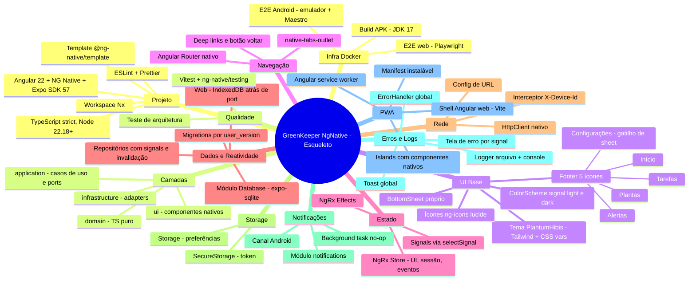
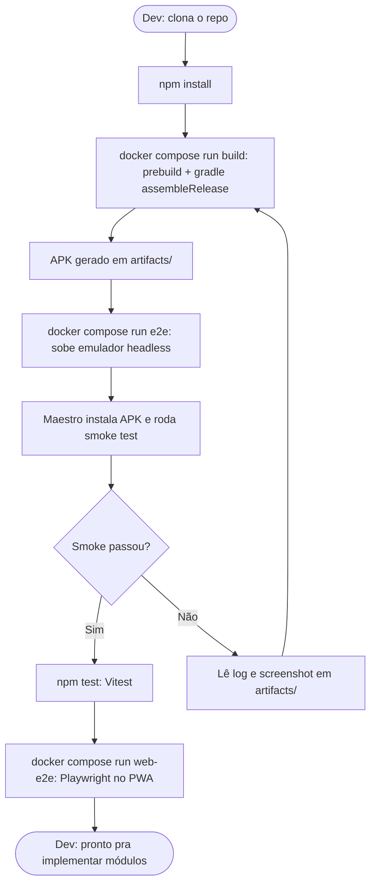
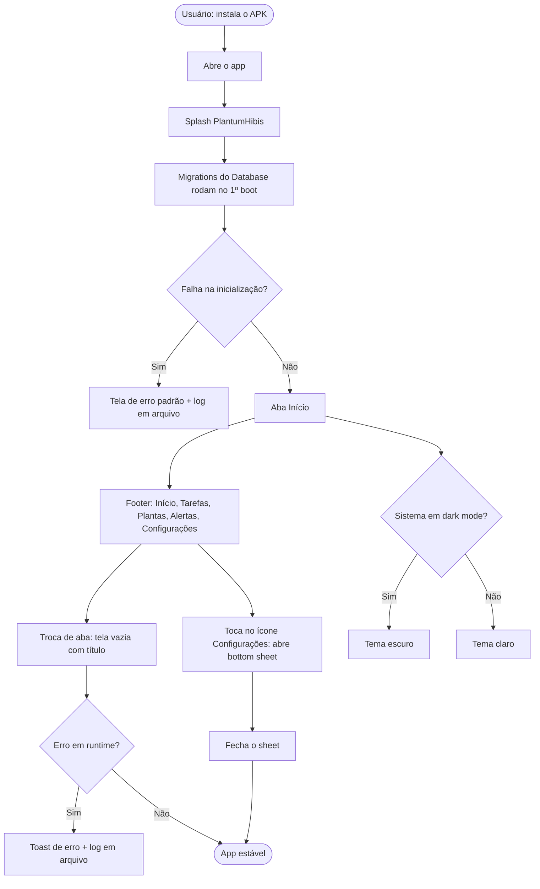
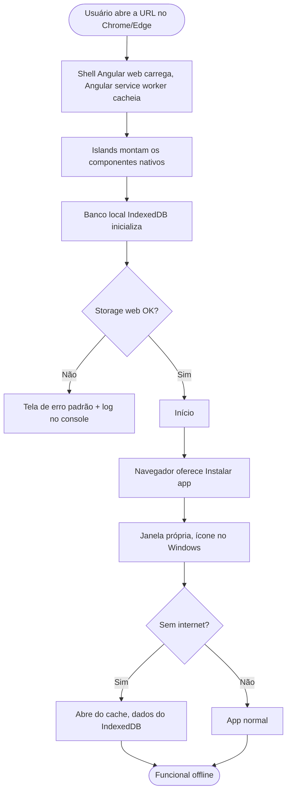
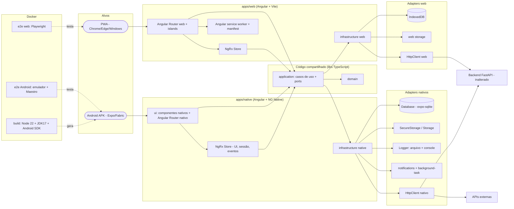

## Visão

**Problema:** Wesley quer a mesma base de app GreenKeeper/PlantumHibis em Angular (stack que domina), em vez de React, mantendo Android 100% nativo, build e E2E reproduzíveis por Docker e um PWA instalável. O NG Native (Angular 22 renderizando views nativas via Fabric/Expo) é a candidata, mas está em **alpha**, então a base precisa ser construída com spikes que validem a viabilidade antes de migrar módulos.
**Solução:** App GreenKeeper/PlantumHibis em **Angular 22 + NG Native + Expo SDK 57**, com os mesmos princípios do esqueleto React Native: sem módulos de negócio, camadas Clean Architecture, tema, 4 abas + sheet, banco local, **NgRx** só para estado de UI/sessão/eventos, logs, erros, notificações base, PWA, build do APK e E2E (Maestro + Playwright) via Docker. O PWA é um **shell Angular web** (Angular Router web + `@angular/service-worker`) que monta os componentes nativos como islands, compartilhando `domain` e `application` com o app nativo. Roadmap de módulos idêntico ao RN.
**Usuários-alvo:** Wesley (dev) nesta change; usuários de plantas em Android e no PWA a partir das changes de módulos.

## Mapa Funcional

## Jornadas de Usuário

As jornadas de **Dev**, **Usuário Android** e **Usuário PWA** são as mesmas do esqueleto RN (`GreenKeeper.Frontend.Reactnative`), com estas diferenças: `npm test` roda Vitest; o erro fatal passa pelo `ErrorHandler` do Angular e abre a tela de erro; o PWA carrega o shell Angular web, o Angular service worker cacheia os assets e as islands montam os componentes nativos.

### Dev

### Usuário Android

### Usuário PWA

## Arquitetura Macro

## Funcionalidades por Área

| Funcionalidade | Ator | Prioridade | Complexidade |
|---|---|---|---|
| Workspace Nx + app nativo (NG Native) + shell web + libs compartilhadas | Dev | Alta | G |
| TypeScript strict, ESLint/Prettier, fronteiras de camadas | Dev | Alta | M |
| Angular Router nativo com 4 abas e ícone ⚙ como gatilho de sheet | Usuário | Alta | M |
| Tema PlantumHibis light/dark (Tailwind + CSS vars + ColorScheme) | Usuário | Alta | M |
| Ícones ng-icons Lucide | Usuário | Média | P |
| BottomSheet próprio (`modal` + animação) e sheet de Configurações | Usuário | Alta | G |
| NgRx Store (UI/sessão/eventos) + regra "sem entidades" | Dev | Alta | M |
| Database (expo-sqlite) com migrations e colunas base | Dev | Alta | G |
| Repositórios reativos por signal com invalidação | Dev | Alta | G |
| Adapter IndexedDB atrás do mesmo port (web) | Dev | Alta | G |
| HttpClient nativo + interceptor `X-Device-Id` + erros tipados | Dev | Alta | M |
| SecureStorage / Storage e equivalentes web atrás de port | Dev | Média | M |
| Logger em arquivo (Android) + console | Dev | Alta | M |
| ErrorHandler global + tela de erro + toast padrão | Usuário | Alta | M |
| Base de notificações (canal, toast global, background task) | Dev | Média | M |
| PWA: shell Angular web, islands, service worker, manifest | Usuário | Alta | G |
| Docker build do APK (JDK 17 + Android SDK) | Dev | Alta | G |
| Docker E2E Android (emulador + Maestro) | Dev | Alta | G |
| Docker E2E web (Playwright) | Dev | Média | M |
| Vitest + @ng-native/testing + teste de arquitetura | Dev | Alta | M |
| .gitignore, .graphifyignore, README, CLAUDE/AGENTS/GEMINI, graphify | Dev | Alta | P |

## Viabilidade

- [x] A solução resolve o problema declarado
- [x] Não duplica funcionalidade já existente (repo novo; MAUI e RN seguem como referência)
- [x] Stack definida (Angular 22, NG Native, Expo SDK 57, RN 0.86, NgRx, Vitest, Maestro, Playwright)
- [x] Escopo é delimitável (esqueleto sem negócio; módulos em changes sequenciais)
- [ ] NG Native alpha sustenta o esqueleto (Router, tabs, modal, Database, ícones) em Android real
- [ ] NgRx funciona com o renderer nativo e `provideNativeHttpClient()`
- [ ] Emulador Android em Docker roda neste ambiente (KVM; WSL2 com virtualização aninhada)
- [ ] Islands renderizam o shell web sem depender do router nativo
- [ ] Node 22.18+, JDK 17 e SDK Android compatíveis com Expo SDK 57
- [ ] Estimativa de esforço aceitável (esqueleto maior que o do RN: dois apps + libs)

## Riscos Iniciais

| Risco | Probabilidade | Impacto | Mitigação |
|---|---|---|---|
| NG Native é alpha (APIs 0.x mudam, bugs, poucos contribuidores) | Alta | Alto | Spikes antes de construir; versões fixas; isolar o framework atrás de ports; projeto tratado como avaliação paralela ao RN |
| Sem BottomSheet e sem ErrorBoundary prontos | Alta | Médio | BottomSheet próprio (`modal` + Reanimated); `ErrorHandler` do Angular + tela de erro por signal |
| Sem live query no módulo Database | Alta | Alto | Repositórios com signal de invalidação disparada nas escritas; teste de reatividade por tela; avaliar `addDatabaseChangeListener` do expo-sqlite |
| Router nativo não existe na web | Alta | Alto | Shell web Angular padrão + islands; compartilhar só domain/application/estado |
| Compatibilidade NgRx/bibliotecas Angular com o renderer não documentada | Média | Alto | Spike; fallback: store próprio com signals mantendo as mesmas regras |
| Emulador Android em Docker sem KVM no Windows | Alta | Alto | WSL2 com nested virtualization; plano B runner Linux |
| Expo SDK 57 / RN 0.86 mais novos que o resto do ecossistema (módulos sem suporte) | Média | Médio | Fixar versões do template; verificar cada módulo no spike |
| Esqueleto grande (2 apps + libs + Docker) | Média | Médio | Tasks granuladas, commit por grupo, spikes primeiro |

## Fora de Escopo

- Telas e regras de negócio: auth, casas, áreas, plantas, tarefas, alertas, perfil, sync, dashboard (changes 2 a 10).
- Sync com o Backend (só o cliente HTTP base).
- Lógica de alertas e permissão de notificação (só a base).
- Hospedagem/deploy do PWA.
- iOS e builds nativos Windows.
- Alterações no Backend FastAPI, no repo MAUI e no repo React Native.
- Toggle manual de tema.
- i18n completa (suporte parcial no NG Native), `@angular/animations` e SSR/hidratação (não suportados).
- Publicação na Play Store e assinatura de release.
